# Web Development - Week 1

Three frontend assignments for WeIntern Pvt Ltd, built by [Suraj Kumar](https://github.com/Suraj96504).

## Objective

Practice semantic HTML, responsive CSS, Flexbox, CSS Grid, light JavaScript interactions, and project documentation.

## Projects and live demos

| Task | Project | Live demo | Documentation |
|---|---|---|---|
| 1 | Professional Portfolio | [Open demo](https://suraj96504.github.io/week-1-assiment/week1-assignments/portfolio-website/) | [README](portfolio-website/README.md) |
| 2 | Sprout Studio Landing Page | [Open demo](https://suraj96504.github.io/week-1-assiment/week1-assignments/business-landing-page/) | [README](business-landing-page/README.md) |
| 3 | CSS Layout Lab | [Open demo](https://suraj96504.github.io/week-1-assiment/week1-assignments/css-challenge/) | [README](css-challenge/README.md) |

- [All projects](https://suraj96504.github.io/week-1-assiment/week1-assignments/)
- [GitHub repository](https://github.com/Suraj96504/week-1-assiment)

## Tech stack and features

HTML5, CSS3, and vanilla JavaScript, without external UI libraries or a build step.

- Portfolio: four pages, project filtering, persistent theme toggle, and a demo contact form.
- Landing page: studio branding, concept work, services, and a validated demo contact form.
- CSS challenge: Flexbox cards, a six-item Grid layout, hover effects, and a loading animation.
- Responsive layouts, visible keyboard focus, and reduced-motion styles.

## Folder structure

```text
week1-assignments/
    index.html
    README.md
    VERIFICATION.md
    portfolio-website/
    business-landing-page/
    css-challenge/
```

Each project contains its HTML, `css/`, `js/`, `screenshots/`, and README. The portfolio also contains `about.html`, `projects.html`, and `contact.html`.

## Run locally

From the repository root:

```powershell
python -m http.server 8000 --directory week1-assignments
```

Open http://localhost:8000/ and choose a project. No dependency installation is required. Individual HTML pages can also be opened directly.

## Screenshots

Twelve screenshots are included, four per project:

### Professional Portfolio

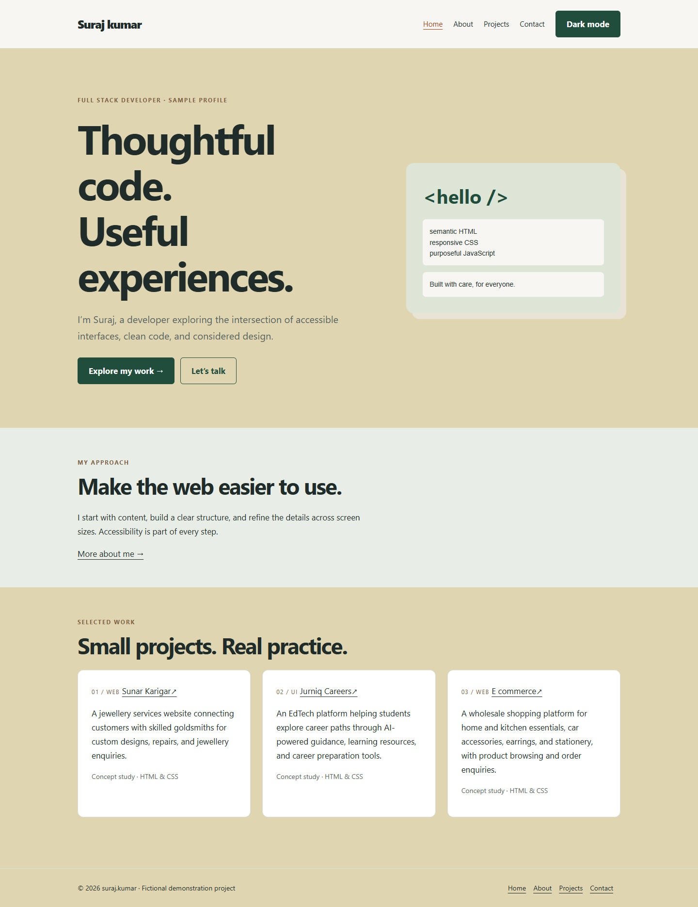

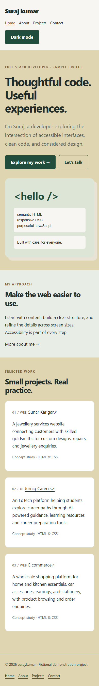

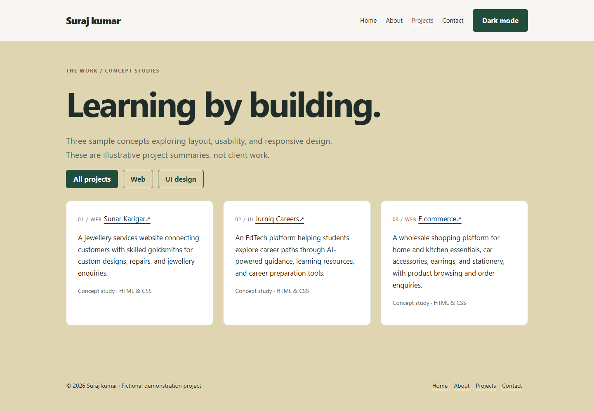

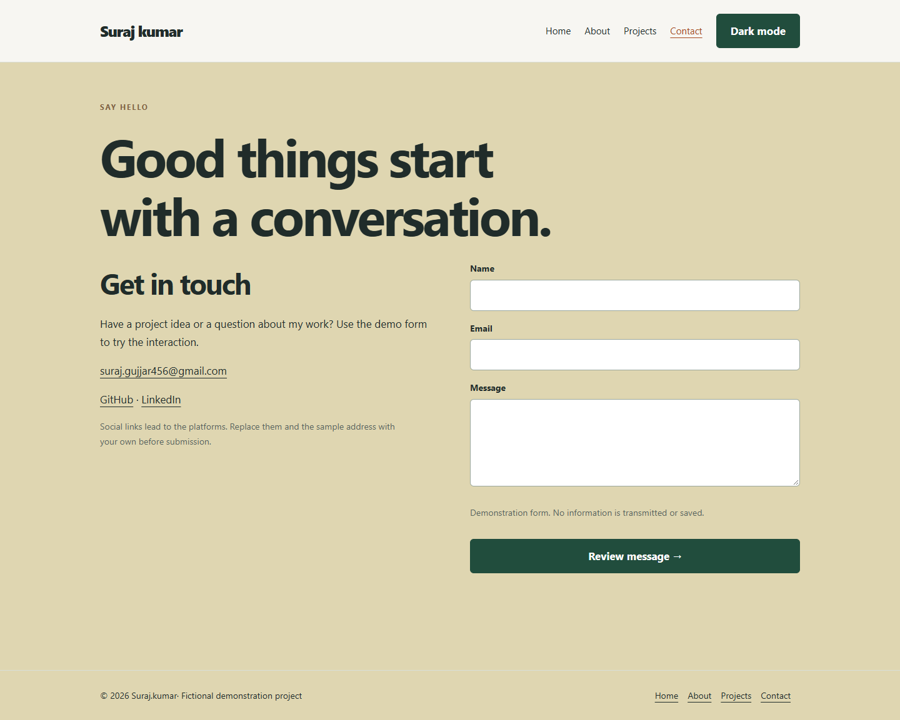

### Sprout Studio Landing Page

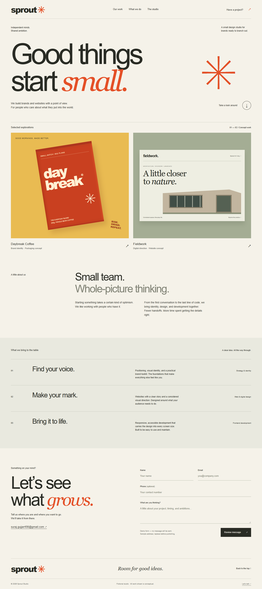

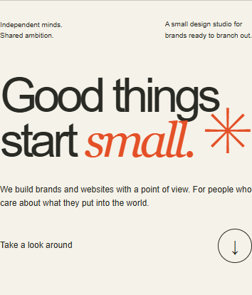

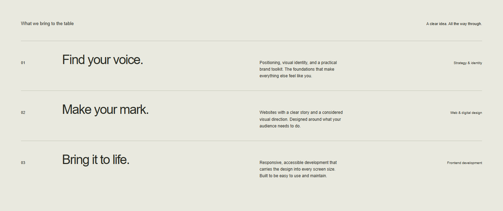

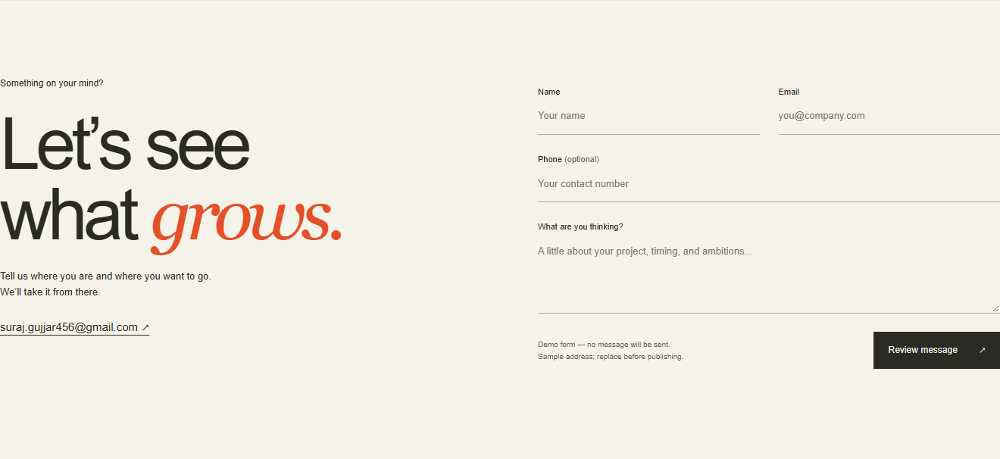

### CSS Layout Lab

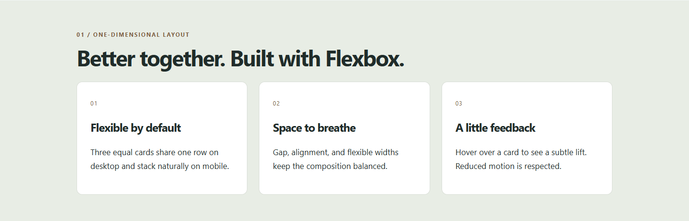

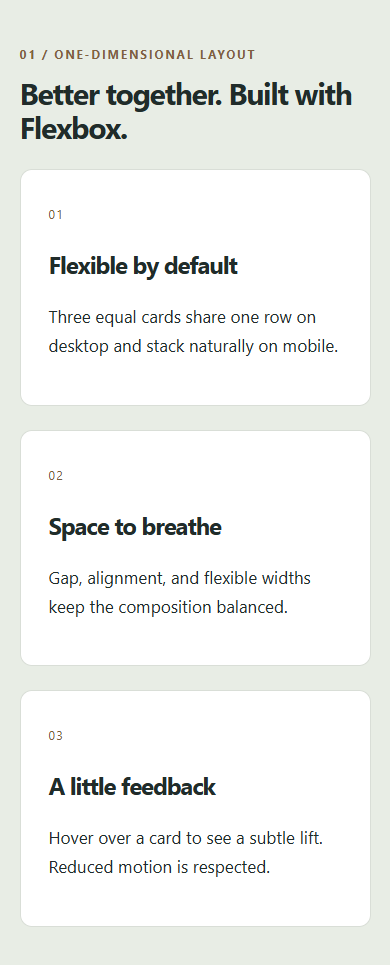

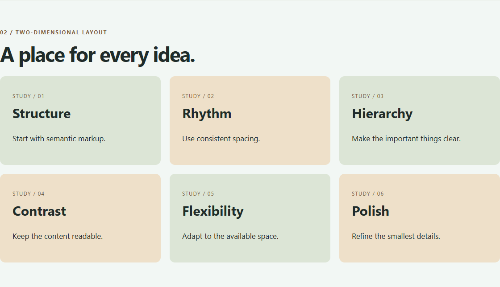

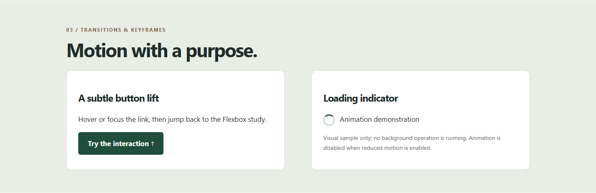

## Validation and limitations

Local Chromium checks covered six project pages at 390px, 768px, and 1440px, local links and anchors, theme persistence, project filters, form validation, reduced motion, and script errors. See [verification notes](VERIFICATION.md).

Contact forms demonstrate validation and local feedback; they do not deliver messages. Some content remains illustrative. Review personal details, external profile links, and the deployed pages on a phone before final submission. Local checks do not establish cross-browser or live deployment compatibility.

## Deployment

Published through GitHub Pages using `main` and `/ (root)`. Project URLs include `/week1-assignments/` because the project directory is nested inside the repository. Push final changes to `main` and wait for the Pages deployment to finish before reviewing the live demos.

## Author

[Suraj Kumar](https://github.com/Suraj96504)
