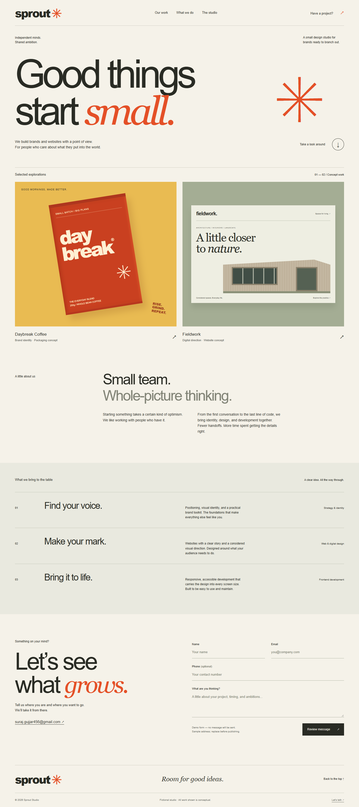
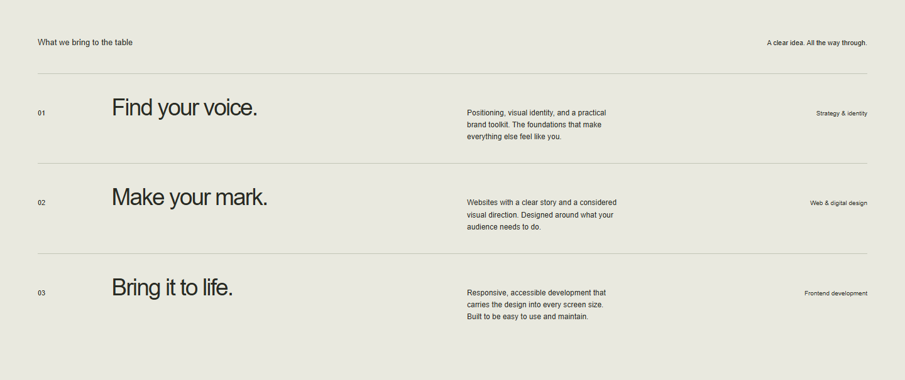

# Sprout Studio Landing Page

Week 1 assignment built using semantic HTML5, CSS3, and vanilla JavaScript. No build step, external UI library, or network assets are required.

## Objective and features

Responsive navigation, illustrated hero, three services, studio process, contact CTA, and a labeled form with name, email, optional phone, and message.

## Run

Open `index.html` directly, or from the parent folder run `python -m http.server 8000` and visit this project at `http://localhost:8000/business-landing-page/`.

## Structure

- `index.html`: entry point (portfolio also includes about, projects, contact).
- `css/style.css`: styles, breakpoints, and reduced-motion rules.
- `js/script.js`: lightweight browser interactions.
- `screenshots/`: desktop and mobile captures.

## Content and form limitations

Author: sample assignment implementation; replace with your own name. All people, business details, and concept projects are illustrative. Replace sample email addresses and platform homepage links before submitting. Forms use HTML validation and an accessible local status message; they do not send email or store messages. A real contact flow needs a backend or form service.

## Deployment

Not published. To deploy through GitHub Pages, upload the complete `week1-assignments` directory as repository contents, then enable Pages for the main branch and repository root in Settings. Add the actual repository and live URLs here after publishing. Never put secrets in frontend code.

## Screenshots

See `screenshots/`. Review at desktop, tablet, and mobile sizes before final submission.

## Captured views

