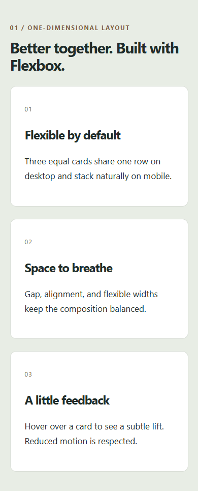
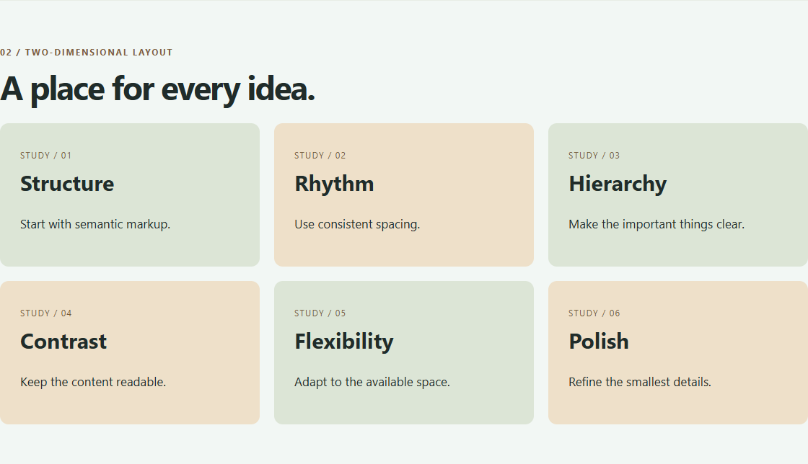
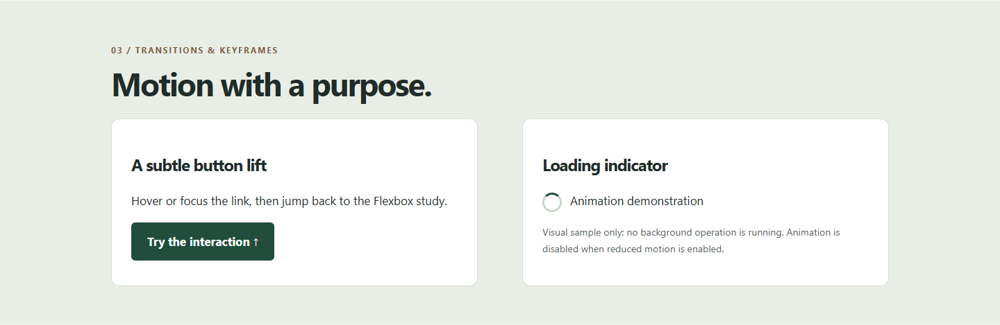

# CSS Layout Lab

Week 1 web development assignment for WeIntern Pvt Ltd.

## Objective

Demonstrate responsive Flexbox, CSS Grid, and subtle CSS animation.

## Tech stack

HTML5, CSS3, and vanilla JavaScript. No external UI library, package installation, or build step is required.

## Features

- Three Flexbox cards that stack on smaller screens.
- Six grid items with repeat() columns and responsive layout.
- Button and card hover transitions.
- Keyframe loading spinner and reduced-motion support.

## Project structure

- `index.html`: page markup.
- `css/style.css`: typography, layouts, responsive rules, and interaction styles.
- `js/script.js`: browser interactions.
- `screenshots/`: four required desktop, mobile, and component captures.
- `README.md`: project documentation.

## Run locally

From the repository root:

```powershell
python -m http.server 8000 --directory week1-assignments
```

Open http://localhost:8000/css-challenge/. You can also open this project's `index.html` directly.

## Repository and deployment

- [GitHub repository](https://github.com/Suraj96504/week-1-assiment)
- [Live project](https://suraj96504.github.io/week-1-assiment/week1-assignments/css-challenge/)

Hosted using GitHub Pages from the `main` branch and repository root. The project lives inside `week1-assignments/css-challenge/`.

## Screenshots








## Author

[Suraj Kumar](https://github.com/Suraj96504)
