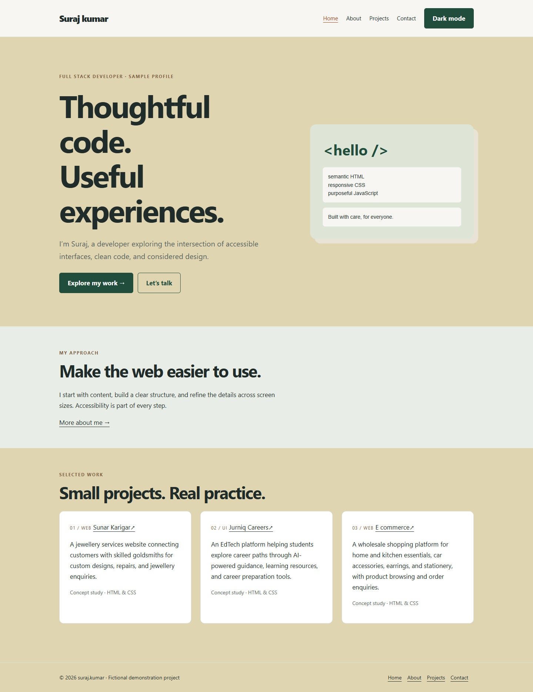
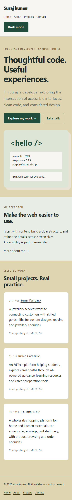
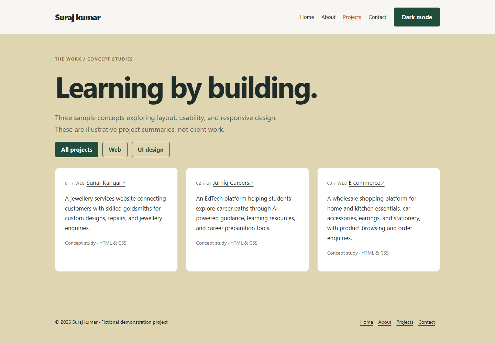
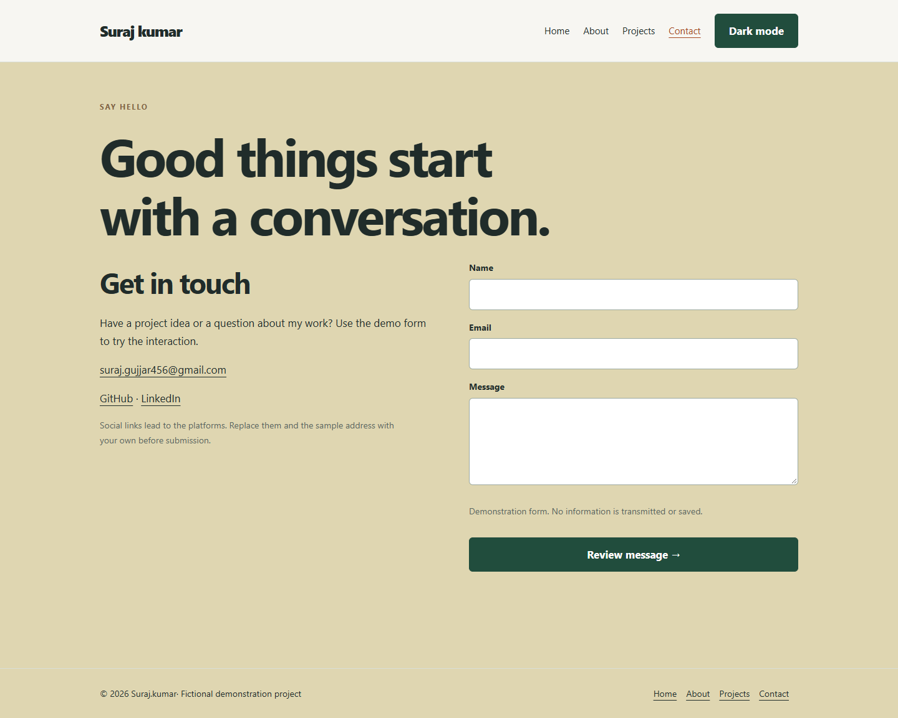

# Professional Portfolio

Week 1 web development assignment for WeIntern Pvt Ltd.

## Objective

Build a responsive developer portfolio with Home, About, Projects, and Contact pages.

## Tech stack

HTML5, CSS3, and vanilla JavaScript. No external UI library, package installation, or build step is required.

## Features

- Four linked pages with semantic HTML.
- Skills and project showcases.
- Project category filtering.
- Persistent dark and light themes.
- Contact form with HTML validation and a local status message.

## Project structure

- `index.html, about.html, projects.html, contact.html`: page markup.
- `css/style.css`: typography, layouts, responsive rules, and interaction styles.
- `js/script.js`: browser interactions.
- `screenshots/`: four required desktop, mobile, and component captures.
- `README.md`: project documentation.

## Run locally

From the repository root:

```powershell
python -m http.server 8000 --directory week1-assignments
```

Open http://localhost:8000/portfolio-website/. You can also open this project's `index.html` directly.

## Repository and deployment

- [GitHub repository](https://github.com/Suraj96504/week-1-assiment)
- [Live project](https://suraj96504.github.io/week-1-assiment/week1-assignments/portfolio-website/)

Hosted using GitHub Pages from the `main` branch and repository root. The project lives inside `week1-assignments/portfolio-website/`.

## Content and form behavior

Forms use HTML validation and display a demo status message. They do not send email or store submissions. Some profile, contact, or concept content is illustrative; review personal details and social destinations before submission.

## Screenshots









## Author

[Suraj Kumar](https://github.com/Suraj96504)
